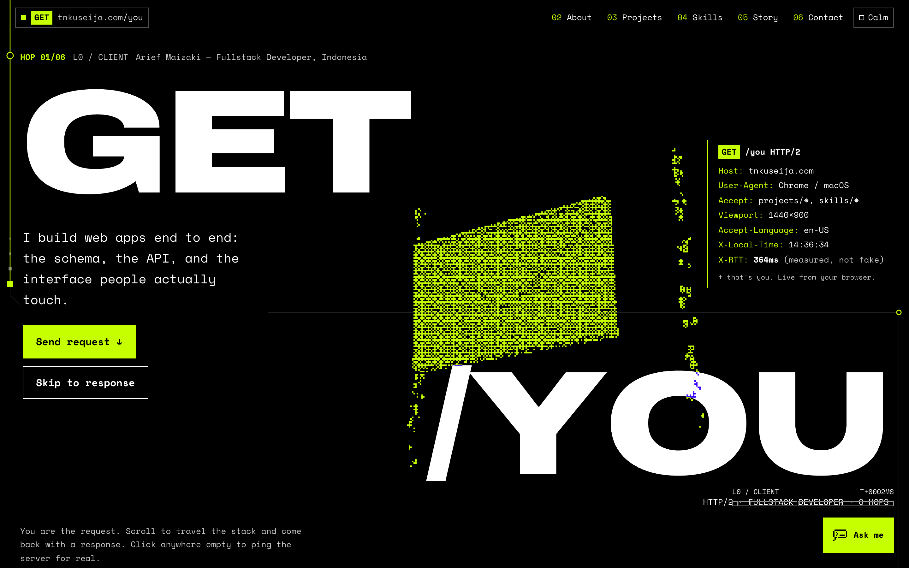
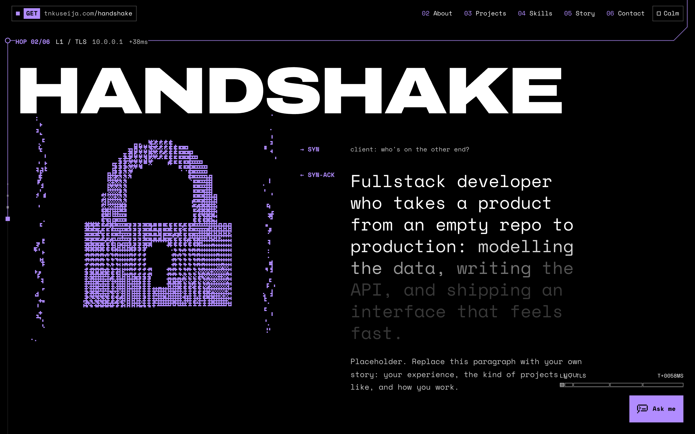
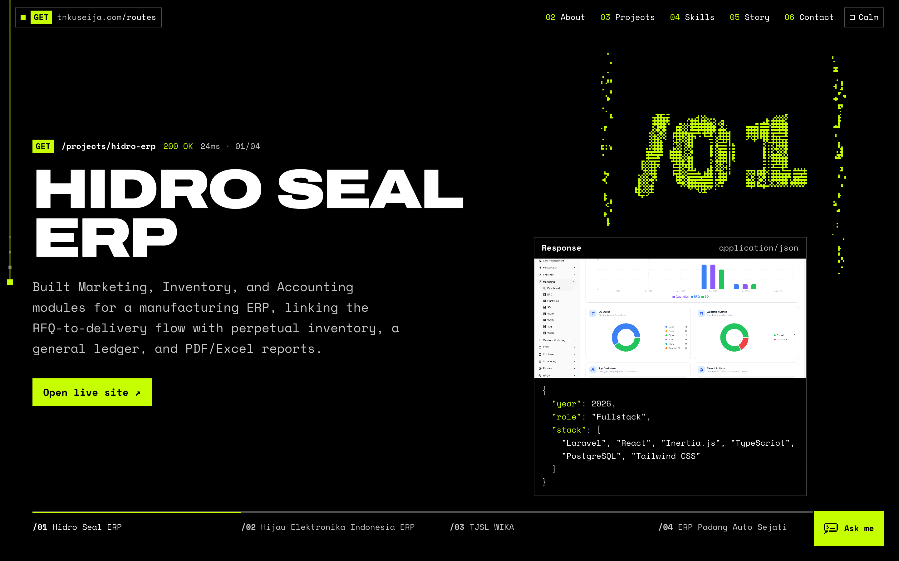
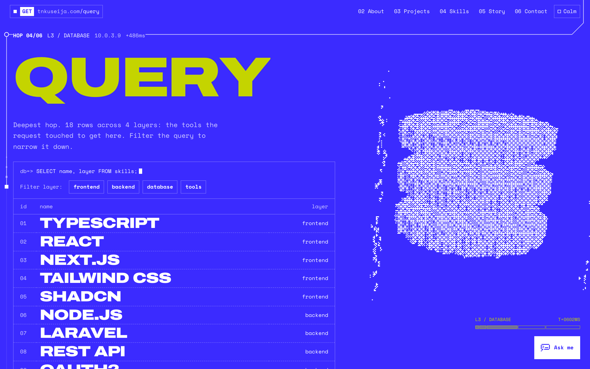
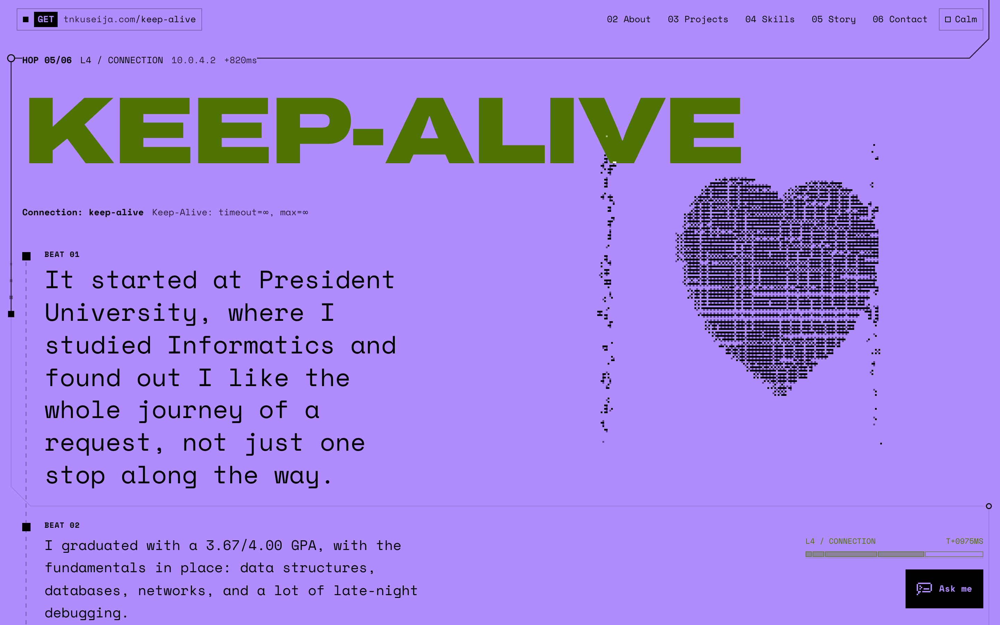
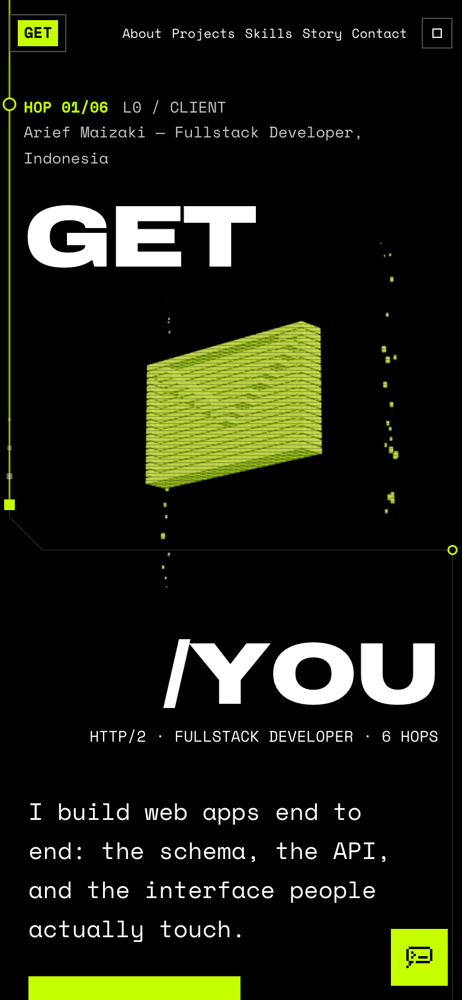

# Round Trip — portfolio

A full-stack developer portfolio where **the visitor is an HTTP request**. Scrolling the page sends that request through the stack, one hop at a time, while a 3D voxel stage behind the content rebuilds itself for every hop.



| Hop | Section | What happens |
| --- | --- | --- |
| 01 | **Request** | `GET /you` — the hero |
| 02 | **Handshake** | SYN / SYN-ACK / ACK, a TLS-style certificate, and an AI terminal you can talk to |
| 03 | **Routes** | Each project is an endpoint with its own JSON response |
| 04 | **Query** | Skills as a filterable `SELECT … FROM skills` table |
| 05 | **Keep-Alive** | `Connection: keep-alive` — the owner's story, told as numbered beats |
| 06 | **Response** | `200 OK`, with contact details sent back as response headers |

All content is edited in a private admin panel and stored in PostgreSQL.

## Screenshots

| | |
| --- | --- |
|  |  |
| **Handshake** — the voxels form a lock | **Routes** — every project is an endpoint, and the voxels spell its number |
|  |  |
| **Query** — skills as a filterable SQL table | **Keep-Alive** — the story, beat by beat |

<p align="center">
  
  <br>
  <sub>On phones the stage switches to <code>lite</code> mode: fewer cubes, no post-processing.</sub>
</p>

## Features

**Public site**

- Full-screen voxel stage (React Three Fiber, one `InstancedMesh`, up to 4096 cubes) that morphs between an envelope, a lock, a database, a heart, `200`, and route numbers (`/01`, `/02`, …).
- Custom 1-bit dither post-process with scanlines and a "packet loss" glitch that reacts to mouse speed and chapter changes.
- Real network data: round-trip time is measured with `HEAD` requests to the page itself; clicking empty space sends a ping.
- Headings that reassemble from out-of-order "packets", a PCB-style trace that follows the scroll, a per-hop tab title and favicon, and a `curl`-style boot screen.
- **AI terminal**: built-in commands (`traceroute`, `ping`, …) plus free-form questions answered by Claude, streamed from `/api/chat`. Answers use only the site's data, follow the visitor's language, and are rate-limited per IP, per session, and globally.
- Three render modes: `full` (desktop), `lite` (phones and tablets: fewer cubes, no post-processing), and `off` (reduced motion or no WebGL).
- **Calm mode** toggle that turns off the busy effects. `prefers-reduced-motion` is respected everywhere.
- Cookie-free analytics: one view per tab and one event per hop. Skipped under Do Not Track / GPC. Raw IP addresses are never stored.

**Admin panel (`/admin`)**

- Google sign-in through self-hosted Better Auth. Only emails listed in `ADMIN_EMAILS` can create an account.
- Dashboard with visits, hop funnel, chat volume, and estimated AI cost (7 / 30 / 90 days).
- Read every AI conversation.
- Edit the profile, Keep-Alive story, skills, and projects (with thumbnail upload to S3-compatible storage).
- "Easter eggs": notes about people the AI may be asked about.
- Saving content refreshes the cached home page immediately (`updateTag`).

## Tech stack

| Area | Tools |
| --- | --- |
| Framework | Next.js 16 (App Router, Cache Components, Turbopack), React 19, TypeScript |
| Styling | Tailwind CSS 4, Archivo Variable + Space Mono |
| Motion / 3D | GSAP (ScrollTrigger, SplitText), Lenis, three.js, React Three Fiber, postprocessing |
| Data | PostgreSQL, Prisma 7 with `@prisma/adapter-pg` |
| Auth | Better Auth (Google OAuth) |
| AI | Anthropic SDK (`@anthropic-ai/sdk`), default model `claude-haiku-5-5` |
| Storage | S3-compatible object storage (Neon Object Storage) via `@aws-sdk/client-s3` |
| Preview build | Vite (single self-contained HTML file) |

## Getting started

### Requirements

- Node.js 20.19 or newer
- PostgreSQL (local, or a hosted database such as Neon)
- Optional: an Anthropic API key, a Google OAuth client, and an S3-compatible bucket. The public site works without them; only the AI terminal, admin login, and thumbnail upload need them.

### Setup

```bash
git clone <repo-url> portfolio
cd portfolio
npm install            # also runs `prisma generate`

cp .env.example .env   # then fill in the values (see below)

npm run db:migrate     # create the tables
npm run db:seed        # fill them with the default content from src/data
npm run dev            # http://localhost:3000
```

If the database is unreachable or empty, the site falls back to the default content in `src/data`, so the page still renders.

### Environment variables

All variables are documented in [`.env.example`](.env.example).

| Variable | Required for | Notes |
| --- | --- | --- |
| `DATABASE_URL` | Everything that uses the database | Use `sslmode=verify-full` in production |
| `ANTHROPIC_API_KEY` | AI terminal | Without it, `/api/chat` returns 503 and the terminal reports the AI as offline |
| `CHAT_MODEL` | — | Optional. Defaults to `claude-haiku-5-5`. Add its price to `PRICES` in `src/lib/chat.ts` so cost estimates stay correct |
| `CHAT_LIMIT_PER_10MIN`, `CHAT_LIMIT_PER_DAY`, `CHAT_LIMIT_GLOBAL_DAY`, `CHAT_LIMIT_PER_SESSION` | — | Optional rate limits (defaults 10 / 40 / 500 / 20) |
| `BETTER_AUTH_SECRET` | Admin | At least 32 random characters: `openssl rand -base64 32` |
| `BETTER_AUTH_URL` | Admin | Base URL of the app, e.g. `http://localhost:3000` |
| `GOOGLE_CLIENT_ID`, `GOOGLE_CLIENT_SECRET` | Admin | Redirect URI: `<BETTER_AUTH_URL>/api/auth/callback/google` |
| `ADMIN_EMAILS` | Admin | Comma-separated list of Google accounts allowed in |
| `AWS_ACCESS_KEY_ID`, `AWS_SECRET_ACCESS_KEY`, `AWS_ENDPOINT_URL_S3`, `AWS_REGION`, `STORAGE_BUCKET` | Thumbnail upload | The bucket must allow public reads. Max upload size is 4 MB |
| `IP_SALT` | Rate limiting | Long random string used to hash visitor IPs |

## Scripts

| Command | Description |
| --- | --- |
| `npm run dev` | Start the dev server |
| `npm run build` / `npm start` | Production build / serve it |
| `npm run lint` | ESLint |
| `npx tsc --noEmit` | Type check |
| `npm run preview:single` | Build the home page into one self-contained `preview-dist/index.html` (no server, no database) |
| `npm run db:migrate` | Create and apply migrations in development |
| `npm run db:deploy` | Apply migrations in production |
| `npm run db:seed` | Seed the database from `src/data` (safe to run more than once) |
| `npm run db:generate` | Regenerate the Prisma client |
| `npm run db:studio` | Open Prisma Studio |

## Project structure

```
src/
├── app/
│   ├── page.tsx               # home page (renders <Home content>)
│   ├── admin/                 # admin panel, login, Server Actions
│   ├── api/                   # chat, track, auth handlers
│   └── styleguide/            # design-token reference page
├── components/
│   ├── sections/              # one server component per hop + its *Fx.tsx animation client
│   ├── three/                 # voxel stage, scene, dither effect
│   ├── fx/                    # boot screen, circuit trace, terminal, cursor, analytics …
│   ├── chat/                  # shared chat state + floating chat panel
│   └── admin/                 # admin UI primitives, charts, forms
├── lib/                       # stage state, GSAP setup, content cache, auth, chat, stats
└── data/                      # default content (seed source + offline fallback)
prisma/                        # schema, migrations, seed
preview/                       # entry point for the single-file Vite build
```

## How it works

- **Stage state lives outside React.** `src/lib/stage.ts` is a plain mutable object (current hop, target shape, colors, glitch). Scroll triggers update it, and the 3D scene reads it every frame, so scrolling never causes a React re-render.
- **Each hop is configured in one place.** `CHAPTERS` in `src/lib/stage.ts` sets the shape, colors, and labels for every hop. Chapter colors are also written to CSS variables, so the page UI follows the stage.
- **Content is cached.** `getContent()` is a `"use cache"` function, so the home page is served from the static shell. Admin actions call `updateTag()` after every write to refresh it.
- **The AI never sees client history.** Chat history is loaded from the database by session id. The system prompt is built from the site content and is prompt-cached.

See [`CLAUDE.md`](CLAUDE.md) for the full architecture notes.

## Deployment

The app is built for Vercel (or any Node host behind a proxy that sets `x-forwarded-for`):

1. Set all environment variables. `BETTER_AUTH_URL` must be the production URL.
2. Add the production redirect URI to the Google OAuth client.
3. Run `npm run db:deploy` against the production database, then `npm run db:seed` once.
4. Deploy. Use `npm run build` as the build command.

## Customizing

1. Sign in at `/admin` and replace the placeholder profile, story, skills, and projects. You can also edit `src/data` before seeding.
2. Project order sets the route numbers (`/01`, `/02`, …) that the voxels form, so put your best project first.
3. Skill group names become the filters in the Query table.
